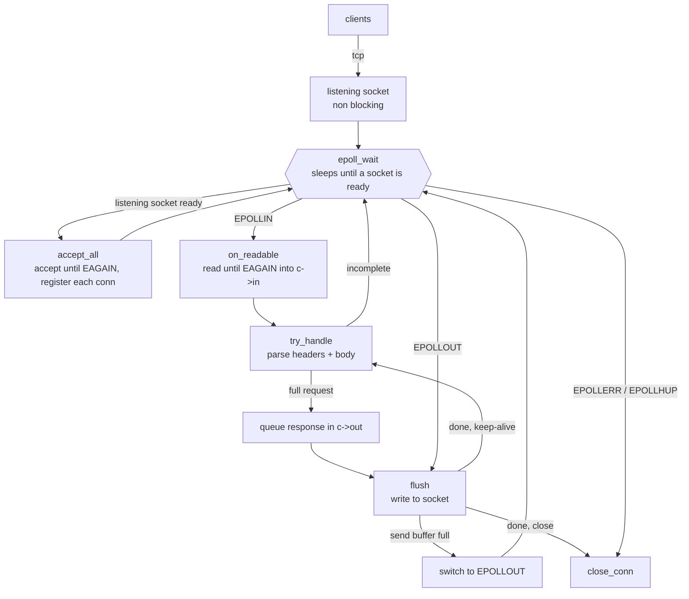

# c-http-server

http/1.1 server in C. raw sockets, a hand rolled parser and one epoll loop. no threads, no libraries.

~177k req/s with `ab -k -n 20000 -c 100` on an m-series mac (inside docker).

## run

mac doesnt have epoll, so everything runs through docker.

```
make docker-test    # build + smoke tests
make docker-bench   # ab, 20k requests, 100 concurrent, keep-alive
make docker-run     # http://localhost:8080
```

## what it does

| request | response |
|---|---|
| `GET /path` | file from `public/` (`/` serves index.html), content type from the extension, query string ignored |
| `POST /echo` | sends the body back |
| bad request or `..` in path | 400 |
| missing file / unknown POST route | 404 |
| any other method | 405 |
| body over 16KB | 413 |
| path too long | 414 |
| headers too big | 431 |

keep-alive is on by default for 1.1 and opt in for 1.0. pipelined requests work.

## architecture



each connection loops reading, then writing, then reading again until it closes.

## how it works

server.c reads best from the bottom up.

**main** sets up a non blocking listening socket (socket, bind, listen). non blocking means accept, read and write return EAGAIN right away instead of waiting.

**epoll_wait** sleeps until some socket is ready and only returns those. one thread can handle a lot of connections this way because it never sits waiting on a slow client. every socket is registered with a pointer to its `struct conn`, and epoll hands that pointer back on each event (NULL means the listening socket).

**accept_all** takes every pending connection until EAGAIN.

**on_readable** reads until EAGAIN and appends to `c->in`. tcp is a byte stream, so one read can be half a request or 3 requests stuck together. read returning 0 means the client stopped sending, but it might still want the response, so the server answers first and then closes.

**try_handle** is the parser. a request is complete once the headers end (`\r\n\r\n`) and Content-Length bytes of body have arrived. until then it returns 0 and waits for more. after handling a request it memmoves the leftover bytes to the front, since thats probably the next pipelined request.

**flush** sends the response. write can be partial if the kernel send buffer is full, so it switches the socket to EPOLLOUT and finishes later.

## limits

- 16KB buffer per connection, so no big uploads
- files get read fully into memory, big ones should use sendfile()
- the path check just rejects anything with `..` (realpath + prefix check would be better)
- no chunked encoding, url decoding, https or idle timeouts

## next

1. idle timeout: close conns that are quiet for 10s (epoll_wait timeout + last active time on the conn)
2. sendfile() for big files
3. edge triggered (EPOLLET), see what breaks
4. HEAD
